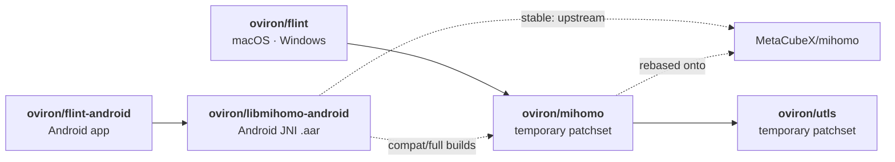

<div align="center">

# libmihomo-android

**Standalone Android JNI library embedding `mihomo` (`libclash.so`, 16 KB page-aligned) with a Kotlin facade.**

**English** · [Русский](README.ru.md)

<p>
  <a href="https://github.com/oviron/libmihomo-android/releases"></a>
  <a href="https://github.com/oviron/libmihomo-android/actions/workflows/ci.yml"></a>
  <a href="https://github.com/oviron/libmihomo-android/releases"></a>
  <a href="https://github.com/MetaCubeX/mihomo"></a>
  <a href="LICENSE"></a>
</p>

<p>
  <a href="#whats-in-each-release">Releases &amp; Verification</a> ·
  <a href="#core-flavors">Core Flavors</a> ·
  <a href="#integration">Integration</a> ·
  <a href="#api-reference">API</a> ·
  <a href="#building-from-source">Build</a> ·
  <a href="#flint-ecosystem">Ecosystem</a>
</p>

</div>

---

Drop the `.aar` into any Android app that needs a configurable proxy core (VPN clients, network testing, traffic shaping) without forking ClashMetaForAndroid or maintaining your own cgo build pipeline.

The Kotlin facade exposes a small, typed API around mihomo's Go `//export` boundary plus lambda-friendly overloads for Kotlin code. It does not bake in proxy presets, routing strategies, or opinionated defaults; those belong to the host app.

**Why this repo exists:** ClashMetaForAndroid uses an in-tree cgo bridge consumed only by its own APK, KaringX's `libclash-vpn-service` is closed-source ([issue #350](https://github.com/KaringX/karing/issues/350)), and [AndroidLibV2rayLite](https://github.com/2dust/AndroidLibV2rayLite) wraps v2ray rather than mihomo. This library was extracted from [oviron/flint-android](https://github.com/oviron/flint-android) (originally forked from FlClash) so any GPL-3.0 Android client can consume the same signed `.aar`.

## Core Flavors

- **Stable releases (`v0.3.x`, `main` branch):** embed clean upstream **[MetaCubeX/mihomo](https://github.com/MetaCubeX/mihomo)**.
- **Optional prereleases (`v0.3.x-compat.N` and `v0.3.x-full.N`):** temporarily embed the `compat` and `full` layers of **[oviron/mihomo](https://github.com/oviron/mihomo)** (current browser TLS fingerprints and Xray-core 26.11.9 interoperability) while upstream catches up. In [Flint for Android](https://github.com/oviron/flint-android), these can be swapped at runtime without rebuilding the APK.

## What's in each release

Each `v*` tag attaches four files to its GitHub Release:

| File | Description |
| :--- | :--- |
| `libmihomo-android-vX.Y.Z.aar` | Android library, all three ABIs (`arm64-v8a`, `armeabi-v7a`, `x86_64`) plus the Kotlin facade |
| `libmihomo-android-vX.Y.Z.aar.sha256` | SHA-256 checksum |
| `libmihomo-android-vX.Y.Z.aar.asc` | GPG detached signature |
| `libmihomo-android-vX.Y.Z.metadata.json` | Machine-readable manifest: bundled mihomo version, `bridgeABI`, ABIs, AAR SHA-256 |

Verify before consuming:

```sh
sha256sum -c libmihomo-android-vX.Y.Z.aar.sha256

# One-time: import maintainer public key from this repo
gpg --import oviron-signing.pub.asc
gpg --verify libmihomo-android-vX.Y.Z.aar.asc libmihomo-android-vX.Y.Z.aar
# Expected: Good signature from "oviron <awdonkin@gmail.com>"
```

Public key fingerprint: `1139 C91B 6525 883E 6783 DCF0 4A94 DA48 8A4C 5033`. Cross-check against the maintainer's GitHub profile (`https://github.com/oviron`) or `keys.openpgp.org` before trusting it.

<details>
<summary><b>Version matrix (v0.1.2 – v0.3.14)</b></summary>

| Wrapper | mihomo core | `bridgeABI` |
| :--- | :--- | :---: |
| `v0.3.14` | `v1.19.34` | 3 |
| `v0.3.13` – `v0.3.12` | `v1.19.33` | 3 |
| `v0.3.11` – `v0.3.6` | `v1.19.32` | 3 |
| `v0.3.5` – `v0.3.4` | `v1.19.31` | 3 |
| `v0.3.3` | `v1.19.30` | 3 |
| `v0.3.2` | `v1.19.29` | 3 |
| `v0.3.1` | `v1.19.28` | 3 |
| `v0.3.0` | `v1.19.27` | 3 |
| `v0.2.0` | `v1.19.27` | 2 |
| `v0.1.5` | `v1.19.27` | 1 |
| `v0.1.4` | `v1.19.26` | 1 |
| `v0.1.3` | `v1.19.25` | 1 |
| `v0.1.2` | `v1.19.24` | 1 |

</details>

## What's inside the `.aar`

Two native libraries per ABI plus a small Kotlin facade:

- **`libclash.so`** — mihomo Go binary built with `-buildmode=c-shared` (~40 MB per ABI), exporting the 11 `//export` bridge functions (`DT_SONAME libclash.so`).
- **`libmihomo-jni.so`** — C++ shim (~14 KB per ABI) translating each `Clash` `external fun` into the matching Go export, with `JNI_OnLoad` wiring callback function pointers.
- **`classes.jar`** — `Clash` (singleton facade), `TunInterface` (VPN `protect` + process resolver hooks), `InvokeInterface` (async result callback).

## Requirements

- **minSdk 21** (Android 5.0+). Built with `-DANDROID_PLATFORM=android-21`.
- **AGP 8.5.1+** in the host APK for 16 KB page alignment on Android 15+. Native `.so` libraries in this `.aar` are 16 KB-aligned with NDK 28.
- **Kotlin 2.2+** in the host app.
- **ABIs:** `arm64-v8a`, `armeabi-v7a`, `x86_64` (no 32-bit `x86`).

## Integration

### Gradle (file dependency)

Pin an exact release version, download it during build, and add it as a file dependency (see `MAINTENANCE.md` for SHA-256 + GPG verification at build time):

```kotlin
// app/build.gradle.kts
val mihomoVersion = "0.3.14"
val mihomoAar = layout.buildDirectory.file("libs/libmihomo-android-v$mihomoVersion.aar")

val downloadMihomo = tasks.register("downloadMihomo") {
    inputs.property("mihomoVersion", mihomoVersion)
    outputs.file(mihomoAar)
    doLast {
        val target = mihomoAar.get().asFile
        target.parentFile.mkdirs()
        val url = "https://github.com/oviron/libmihomo-android/releases/download/v$mihomoVersion/libmihomo-android-v$mihomoVersion.aar"
        target.outputStream().use { out ->
            uri(url).toURL().openStream().use { it.copyTo(out) }
        }
    }
}

dependencies {
    implementation(files(mihomoAar).builtBy(downloadMihomo))
}
```

### Usage from Kotlin

`Clash` does not load its native libraries automatically. The host app chooses *when* and *from where* to load, enabling runtime core swaps (extract another `.aar`'s `jni/<abi>/` directory and pass that path).

```kotlin
import io.github.oviron.libmihomo.Clash
import io.github.oviron.libmihomo.TunInterface

// 1. Load once per process (default: APK nativeLibraryDir).
Clash.load(context.applicationInfo.nativeLibraryDir)

// 2. Verify ABI compatibility.
require(Clash.bridgeABI() == Clash.EXPECTED_BRIDGE_ABI) {
    "Loaded libclash.so reports ABI ${Clash.bridgeABI()}, expected ${Clash.EXPECTED_BRIDGE_ABI}"
}

// 3. Initialize mihomo and apply a profile in one call.
Clash.quickSetup(
    initParams = """{"homeDir": "${context.filesDir}"}""",
    setupParams = """{"profile": "$profilePath"}""",
) { result ->
    if (!result.isNullOrEmpty()) Log.e(TAG, "quickSetup failed: $result")
}

// 4. Implement TunInterface on your VpnService.
class MyVpnService : android.net.VpnService(), TunInterface {
    override fun protect(fd: Int) { super.protect(fd) }
    override fun resolverProcess(
        protocol: Int, source: String, target: String, uid: Int,
    ): String = ""
}

// 5. Hand over the detached TUN fd (do not close ParcelFileDescriptor yourself).
val tunFd = builder.establish()!!.detachFd()
Clash.startTUN(
    fd = tunFd,
    cb = myVpnService,
    device = "my-vpn-app",
    stack = "system",          // "system" | "gvisor" | "mixed" | "mips"
    address = "172.19.0.1/30",
    dns = "1.1.1.1,1.0.0.1",
    mtu = 1400,                // <=0 falls back to 9000
)

// 6. Subscribe to push events (connections, logs, traffic).
Clash.setEventListener { event -> /* JSON payload; see action.go */ }

// 7. Stop before tearing down VpnService.
Clash.stopTun()
```

### Threading & Lifecycle

- Every `Clash.*` call returns immediately; Go work executes on goroutines.
- Callbacks (`TunInterface.protect`, `TunInterface.resolverProcess`, `InvokeInterface.onResult`) run on Go worker threads attached to the JVM — never block them with slow I/O.
- `Clash.load` must succeed before any other method; other methods call `Clash.assertReady()` and throw `IllegalStateException` otherwise.
- Full production reference consumer: **[oviron/flint-android](https://github.com/oviron/flint-android)**.

## API Reference

| Method | Effect |
| :--- | :--- |
| `load(nativeLibDir)` | Loads `libclash.so` + `libmihomo-jni.so` from `nativeLibDir`. Must be called once first. |
| `isLoaded(): Boolean` | Returns `true` once `load` has succeeded. |
| `assertReady()` | Throws `IllegalStateException` if `load` failed or was never called. |
| `bridgeABI(): Int` | Native boundary ABI version; compare against `EXPECTED_BRIDGE_ABI`. |
| `invokeAction(data, cb)` | Dispatches a JSON action document (`src/main/jni/core/action.go`, ~30 methods). |
| `quickSetup(initJson, setupJson, cb)` | One-shot mihomo init + profile apply; empty result string means success. |
| `startTUN(fd, cb, device, stack, address, dns, mtu)` | Starts the TUN listener and takes ownership of detached `fd`. |
| `stopTun()` | Stops the TUN listener and closes its fd. Idempotent. |
| `setEventListener(cb)` | Registers a push-event sink (`null` to clear). |
| `getTraffic(): String` | Current bytes/sec snapshot (JSON). |
| `getTotalTraffic(): String` | Total bytes since process start (JSON). |
| `suspended(suspended: Boolean)` | Releases idle resources (`true`) or wakes the listener (`false`). |
| `forceGC()` | Hints the Go runtime to run GC. |
| `updateDNS(servers)` | Updates the system DNS fallback list (comma-separated IPs). |

> [!NOTE]
> While the wrapper is below `v1.0.0`, treat the API surface as evolving: pin an exact tag (`v0.3.14`, not `v0.+`) and check `CHANGELOG.md` before upgrading. `bridgeABI()` increments on every breaking native boundary change.

## Building from Source

```sh
git clone https://github.com/oviron/libmihomo-android.git
cd libmihomo-android

export ANDROID_NDK=$HOME/Library/Android/sdk/ndk/28.0.13004108
./build-native.sh              # builds libclash.so for all 3 ABIs
./gradlew :assembleRelease     # builds libmihomo-jni.so + build/outputs/aar/libmihomo-android-release.aar
```

See [MAINTENANCE.md](MAINTENANCE.md) for the release pipeline, GPG key rotation, and upstream bump workflow.

## Flint Ecosystem

`libmihomo-android` powers [Flint for Android](https://github.com/oviron/flint-android) and is usable independently by any GPL-3.0 Android app. The `mihomo` and `utls` forks below are **temporary patchsets** maintained only while upstream catches up on specific features.



| Repository | Role | Lifecycle |
| :--- | :--- | :--- |
| **[oviron/flint](https://github.com/oviron/flint)** | Native desktop client (macOS AppKit, Windows WPF) | Standalone app |
| **[oviron/flint-android](https://github.com/oviron/flint-android)** | Android client (Flutter + Kotlin Material 3) | Standalone app |
| **[oviron/libmihomo-android](https://github.com/oviron/libmihomo-android)** | Standalone Android JNI `.aar` library wrapping mihomo | Standalone library |
| **[oviron/mihomo](https://github.com/oviron/mihomo)** | Layered patchset on `MetaCubeX/mihomo` (`utls` / `compat` / `full`) | Temporary upstream bridge |
| **[oviron/utls](https://github.com/oviron/utls)** | Firefox 158, Chrome 155, P-256 key-share & zstd CVE fixes | Temporary upstream bridge |

## License & Security

Licensed under **GNU GPL-3.0** (see [LICENSE](LICENSE)). Upstream mihomo is GPL-3.0 and statically linked into `libclash.so`; per the FSF FAQ, Android apps shipping `libclash.so` are subject to GPL-3.0. If you need a permissive MIT-licensed DPI-bypass library for a proprietary Android app, see [oviron/libbyedpi-android](https://github.com/oviron/libbyedpi-android).

Report bugs in GitHub Issues; for security vulnerabilities see [SECURITY.md](SECURITY.md).
