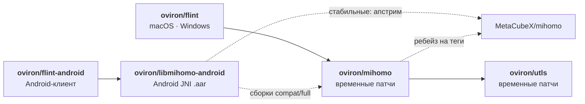

<div align="center">

# libmihomo-android

**Самостоятельная Android JNI-библиотека с ядром `mihomo` (`libclash.so`, выравнивание 16 КБ) и Kotlin-фасадом.**

[English](README.md) · **Русский**

<p>
  <a href="https://github.com/oviron/libmihomo-android/releases"></a>
  <a href="https://github.com/oviron/libmihomo-android/actions/workflows/ci.yml"></a>
  <a href="https://github.com/oviron/libmihomo-android/releases"></a>
  <a href="https://github.com/MetaCubeX/mihomo"></a>
  <a href="LICENSE"></a>
</p>

<p>
  <a href="#состав-релиза-и-проверка">Релизы и проверка</a> ·
  <a href="#варианты-ядра">Варианты ядра</a> ·
  <a href="#интеграция">Интеграция</a> ·
  <a href="#справочник-api">API</a> ·
  <a href="#сборка-из-исходников">Сборка</a> ·
  <a href="#экосистема-flint">Экосистема</a>
</p>

</div>

---

Подключаемый `.aar` для любого Android-приложения, которому нужно прокси-ядро `mihomo` без форка ClashMetaForAndroid и без собственного cgo-пайплайна сборки.

Kotlin-фасад (`Clash`) даёт компактный типизированный API поверх Go-экспортов `mihomo` с поддержкой лямбд. Библиотека не навязывает профили, правила маршрутизации или дефолты — это остаётся на стороне приложения.

**Зачем создан репозиторий:** в ClashMetaForAndroid cgo-мост встроен прямо в APK, `libclash-vpn-service` у KaringX закрыт ([issue #350](https://github.com/KaringX/karing/issues/350)), а [AndroidLibV2rayLite](https://github.com/2dust/AndroidLibV2rayLite) оборачивает v2ray, а не mihomo. Библиотека выделена из [oviron/flint-android](https://github.com/oviron/flint-android) (ранее форка FlClash), чтобы любой открытый Android-клиент мог использовать один подписанный `.aar`.

## Варианты ядра

- **Стабильные релизы (`v0.3.x`, ветка `main`):** собираются на чистом апстриме **[MetaCubeX/mihomo](https://github.com/MetaCubeX/mihomo)**.
- **Опциональные пререлизы (`v0.3.x-compat.N` и `v0.3.x-full.N`):** временно включают слои `compat` и `full` из **[oviron/mihomo](https://github.com/oviron/mihomo)** (актуальные TLS-отпечатки браузеров и совместимость с Xray-core 26.11.9), пока апстрим не догонит эти изменения. В [Flint для Android](https://github.com/oviron/flint-android/blob/main/README.ru.md) их можно переключать прямо в настройках без пересборки APK.

## Состав релиза и проверка

К каждому тегу `v*` в GitHub Releases прикладываются 4 файла:

| Файл | Назначение |
| :--- | :--- |
| `libmihomo-android-vX.Y.Z.aar` | Библиотека для 3 ABI (`arm64-v8a`, `armeabi-v7a`, `x86_64`) + Kotlin-фасад |
| `libmihomo-android-vX.Y.Z.aar.sha256` | Контрольная сумма SHA-256 |
| `libmihomo-android-vX.Y.Z.aar.asc` | Отделённая GPG-подпись |
| `libmihomo-android-vX.Y.Z.metadata.json` | Манифест: версия mihomo, `bridgeABI`, список ABI, SHA-256 |

Проверка перед подключением:

```sh
sha256sum -c libmihomo-android-vX.Y.Z.aar.sha256

# Одноразово: импорт публичного ключа из репозитория
gpg --import oviron-signing.pub.asc
gpg --verify libmihomo-android-vX.Y.Z.aar.asc libmihomo-android-vX.Y.Z.aar
# Ожидается: Good signature from "oviron <awdonkin@gmail.com>"
```

Отпечаток ключа: `1139 C91B 6525 883E 6783 DCF0 4A94 DA48 8A4C 5033`.

## Что внутри `.aar` и требования

- **`libclash.so`** — Go-ядро mihomo (`-buildmode=c-shared`, ~40 МБ на ABI, `DT_SONAME libclash.so`).
- **`libmihomo-jni.so`** — тонкая C++ JNI-прослойка (~14 КБ на ABI).
- **`classes.jar`** — `Clash`, `TunInterface`, `InvokeInterface`.
- **Требования:** `minSdk 21`, AGP 8.5.1+ (библиотеки собраны NDK 28 с выравниванием страниц 16 КБ для Android 15+), Kotlin 2.2+, ABI `arm64-v8a`, `armeabi-v7a`, `x86_64`.

## Интеграция

Подробные примеры Gradle, Kotlin-вызова `Clash.load` / `quickSetup` / `startTUN` / `stopTun`, модель потоков и матрица версий приведены в [английском README](README.md#integration) и [MAINTENANCE.md](MAINTENANCE.md). Полный боевой пример интеграции — [oviron/flint-android](https://github.com/oviron/flint-android).

## Справочник API

| Метод | Действие |
| :--- | :--- |
| `load(nativeLibDir)` | Загружает `libclash.so` и `libmihomo-jni.so` из указанного каталога (позволяет подменять ядро в рантайме). |
| `isLoaded(): Boolean` | `true`, если `load` завершился успешно. |
| `assertReady()` | Бросает `IllegalStateException`, если библиотека не загружена. |
| `bridgeABI(): Int` | Версия нативного ABI-контракта (`EXPECTED_BRIDGE_ABI`). |
| `invokeAction(data, cb)` | Выполняет JSON-действие ядра (`src/main/jni/core/action.go`, ~30 методов). |
| `quickSetup(initJson, setupJson, cb)` | Инициализация mihomo и применение профиля за один вызов. |
| `startTUN(fd, cb, device, stack, address, dns, mtu)` | Запускает TUN на переданном `detachFd()` (библиотека берёт владение fd). |
| `stopTun()` | Останавливает TUN и закрывает fd (идемпотентно). |
| `setEventListener(cb)` | Подписка на push-события ядра (соединения, логи, трафик). |
| `getTraffic()` / `getTotalTraffic()` | Текущая скорость и суммарный трафик (JSON). |
| `suspended(Boolean)` / `forceGC()` / `updateDNS(servers)` | Управление сном, сборщиком мусора Go и системным DNS. |

## Сборка из исходников

```sh
git clone https://github.com/oviron/libmihomo-android.git
cd libmihomo-android

export ANDROID_NDK=$HOME/Library/Android/sdk/ndk/28.0.13004108
./build-native.sh
./gradlew :assembleRelease
```

## Экосистема Flint

`libmihomo-android` используется в [Flint для Android](https://github.com/oviron/flint-android/blob/main/README.ru.md) и подходит для любого GPL-3.0 Android-приложения. Форки `mihomo` и `utls` — **временные наборы патчей**, существующие только пока апстрим отстаёт по конкретным фичам.



| Репозиторий | Роль | Статус |
| :--- | :--- | :--- |
| **[oviron/flint](https://github.com/oviron/flint/blob/main/README.ru.md)** | Нативный десктопный клиент (macOS AppKit, Windows WPF) | Самостоятельный продукт |
| **[oviron/flint-android](https://github.com/oviron/flint-android/blob/main/README.ru.md)** | Android-клиент (Flutter + Kotlin Material 3) | Самостоятельный продукт |
| **[oviron/libmihomo-android](https://github.com/oviron/libmihomo-android/blob/main/README.ru.md)** | Отдельная Android JNI-библиотека `.aar` поверх mihomo | Самостоятельная библиотека |
| **[oviron/mihomo](https://github.com/oviron/mihomo/blob/compat/README.ru.md)** | Слои патчей поверх `MetaCubeX/mihomo` (`utls` / `compat` / `full`) | Временный форк до апстрима |
| **[oviron/utls](https://github.com/oviron/utls/blob/oviron/README.ru.md)** | Firefox 158, Chrome 155, фикс P-256 key share и zstd CVE | Временный форк до апстрима |

## Лицензия и безопасность

Лицензия **GNU GPL-3.0** (см. [LICENSE](LICENSE)). Если нужна MIT-библиотека обхода DPI для закрытого Android-приложения, см. [oviron/libbyedpi-android](https://github.com/oviron/libbyedpi-android). О проблемах безопасности сообщайте по [SECURITY.md](SECURITY.md).
